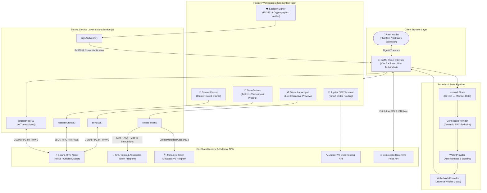
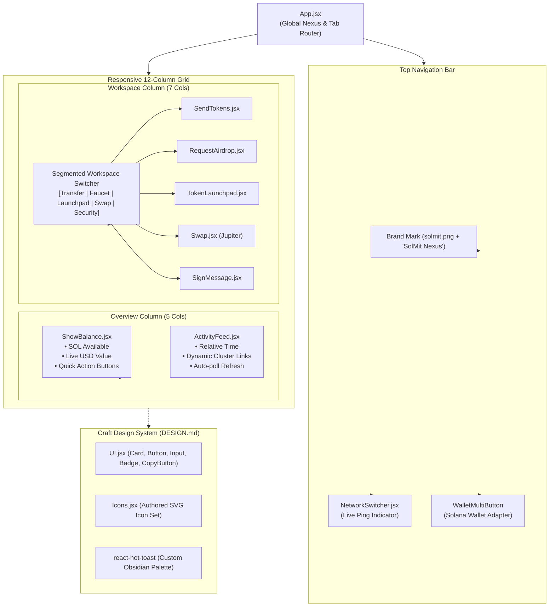

# SolMit — Institutional Solana Nexus

SolMit is a high-performance, institutional-grade Solana Web3 application built for lightning-fast on-chain operations. Engineered with **Impeccable** design craft and **Emil Kowalski’s** interaction standards, SolMit provides a unified interface for asset transfers, devnet faucet distribution, SPL token deployments with Metaplex metadata, Jupiter decentralized swaps, and gasless cryptographic message signing.

---

## 🏗️ Architectural Flow

### 1. High-Level System Architecture

The following diagram illustrates how user requests move from the UI through providers and the service layer down to the Solana runtime, external oracles, and DEX aggregators:



---

### 2. SPL Token Creation Pipeline (Metaplex V3)

When deploying a new token through the **Token Launchpad**, SolMit batches account initialization, token minting, and Metaplex metadata registration into an atomic on-chain transaction:

```mermaid
sequenceDiagram
    autonumber
    actor User as User Wallet
    participant Launch as TokenLaunchpad.jsx
    participant Service as solanaService.js
    participant RPC as Solana Cluster
    participant TokenProg as SPL Token Program
    participant MetaProg as Metaplex Metadata V3

    User->>Launch: Enter Name, Symbol, Image URI & Supply
    Launch->>Launch: Render Real-Time Live Preview Card
    User->>Launch: Click "Deploy Token On-Chain"
    Launch->>Service: createToken({ connection, wallet, name, symbol, imageUrl, supply })
    
    rect rgb(16, 24, 38)
        Note over Service: 1. Generate ephemeral Keypair for Mint
        Service->>RPC: getMinimumBalanceForRentExemption(MINT_SIZE)
        Service->>Service: Build SystemProgram.createAccount(mintKeypair)
        Service->>Service: Build createInitializeMint2Instruction()
        Service->>Service: Build getAssociatedTokenAddressSync(wallet.publicKey)
        Service->>Service: Build createAssociatedTokenAccountInstruction()
        Service->>Service: Build createMintToInstruction(initialSupply * 10^9)
        Service->>Service: Derive Metadata PDA from Mint & Metaplex Program ID
        Service->>Service: Build createCreateMetadataAccountV3Instruction()
    end

    Service->>User: Request transaction approval with [mintKeypair] co-signature
    User->>Service: Approve & Sign Transaction
    Service->>RPC: sendTransaction() & confirmTransaction()
    RPC-->>Service: Confirmation Receipt & Tx Signature
    Service-->>Launch: Return { signature, mintAddress }
    Launch-->>User: Display Mint Address, Copy Button & Solana Explorer Link
```



---

### 3. Component & Layout Graph

The application follows a clean 2-column responsive layout separating persistent wallet metrics from active feature workflows:



---

## ⚡ Key Features

- **SPL Token Launchpad:** Deploy native Solana tokens with Metaplex metadata and real-time live preview cards.
- **Instant Transfer Hub:** Real-time Solana base58 address validation, quick balance percentage presets (`25%`, `50%`, `75%`, `Max`), and fee estimates.
- **Smart Devnet Faucet:** 1-click testnet SOL requests (`0.5`, `1.0`, `2.0` SOL) with automatic rate-limit advisories and Mainnet-to-Devnet switcher.
- **Jupiter DEX Integration:** Embedded Jupiter V6 swap terminal with devnet liquidity warnings and direct routing.
- **Cryptographic Signer:** Gasless message signing with off-chain Ed25519 signature verification and Base58 inspection.
- **Dynamic Cluster Explorer Deep Links:** Direct links to Solana Explorer automatically formatted for Devnet or Mainnet.
- **Live Market Price Feed:** CoinGecko API integration displaying real-time SOL/USD exchange rates.

---

## 📂 Project Structure

```text
Solmit/
├── .env.example                # Safe environment variable template
├── DESIGN.md                   # Impeccable design system & Emil Kowalski motion rules
├── index.html                  # HTML entry with Google Fonts & Jupiter Terminal script
├── package.json                # Project dependencies
├── vite.config.js              # Vite configuration with Node polyfills & Tailwind v4
└── src/
    ├── App.jsx                 # Global state, router, and layout nexus
    ├── App.css                 # Component level overrides
    ├── index.css               # Obsidian theme, scrollbars, and keyframe animations
    ├── main.jsx                # React root mount
    ├── assets/
    │   └── solmit.png          # SolMit emblem logo
    ├── components/
    │   ├── ActivityFeed.jsx    # Real-time transaction feed with dynamic Explorer links
    │   ├── Icons.jsx           # Unified SVG icon library
    │   ├── NetworkSwitcher.jsx # Cluster switch with live ping dots
    │   ├── RequestAirdrop.jsx  # Network-aware Devnet faucet
    │   ├── SendTokens.jsx      # SOL transfer hub with address validation
    │   ├── ShowBalance.jsx     # Wallet balance card & quick actions
    │   ├── SignMessage.jsx     # Security message signer & Ed25519 verifier
    │   ├── Swap.jsx            # Jupiter swap terminal wrapper
    │   ├── TokenLaunchpad.jsx  # Metaplex SPL token creation with live preview
    │   └── UI.jsx              # Reusable design primitives (Card, Button, Input, Badge, CopyButton)
    └── services/
        └── solanaService.js    # Data fetching, RPC calls & Web3 transaction logic
```

---

## 🛠️ Tech Stack

| Category | Technology |
|---|---|
| **Frontend Framework** | React 19 + Vite 6 |
| **Styling & Tokens** | Tailwind CSS v4 + Plus Jakarta Sans + JetBrains Mono |
| **Blockchain Client** | `@solana/web3.js` + `@solana/spl-token` |
| **Token Metadata** | `@metaplex-foundation/mpl-token-metadata` |
| **Wallet Protocol** | `@solana/wallet-adapter-react` + UI Modal |
| **Cryptography** | `@noble/curves` (Ed25519 verification) + `bs58` |
| **DEX Routing** | Jupiter Aggregator Terminal V3 |
| **Market Data** | CoinGecko API |
| **Notifications** | React Hot Toast |

---

## 🚀 Getting Started

### 1. Clone & Install Dependencies
```bash
git clone https://github.com/your-username/solmit.git
cd solmit
npm install
```

### 2. Configure Environment Variables
Copy the sample environment file:
```bash
cp .env.example .env
```
Add your optional custom RPC endpoint (e.g. from [Helius](https://helius.dev)) in `.env`:
```env
VITE_DEVNET_RPC_URL=https://devnet.helius-rpc.com/?api-key=YOUR_API_KEY
VITE_MAINNET_RPC_URL=https://api.mainnet-beta.solana.com
```

### 3. Run Development Server
```bash
npm run dev
```

Open [http://localhost:5173](http://localhost:5173) in your browser.

---

## 🛡️ Security Best Practices

- **Never Commit Secrets:** Never hardcode private keys or RPC API keys in source code. Use `.env` (gitignored).
- **Client-Side Signatures:** Private keys never leave user wallets. All transactions are constructed client-side and sent to the wallet adapter for user approval.
- **Devnet Testing:** Always test SPL token creation, faucets, and transfers on **Devnet** before deploying to Mainnet.

---

## 📄 License
MIT © 2026 SolMit
